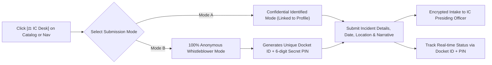
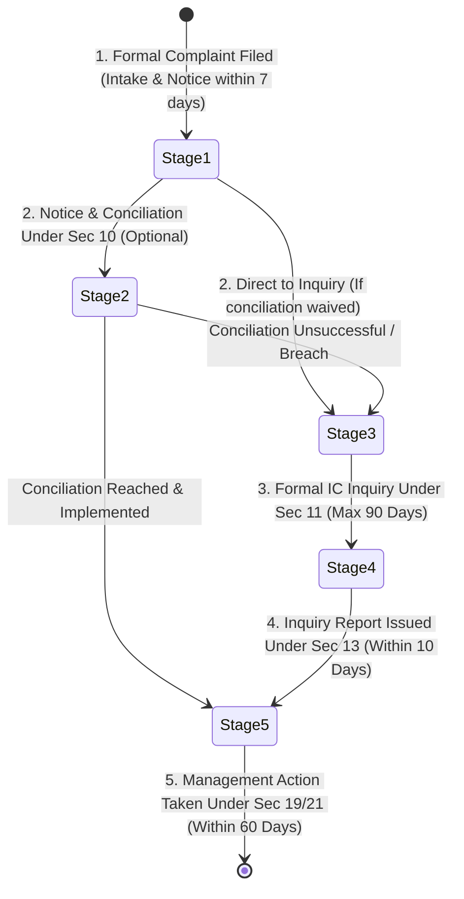

# 📖 User Operational Manual & Role Playbook
**Platform:** LearnPulse / Worxpertise Enterprise E-Learning & Compliance LMS  
**Target Roles:** 🎓 Student / Learner | 👨‍🏫 Faculty / Instructor | 👑 System Administrator & IC Presiding Officer  
**Version:** 3.0 (Enterprise Certified with POSH IC Desk, Recertification & AI Companion)  

---

## 🧭 Role 1: Learner / Student Playbook

### 1.1 Logging into the Academy
1. Navigate to the platform portal (`http://localhost:5000/` or your company's LAN address).
2. Click **Sign In** in the top navigation bar.
3. Enter your corporate email and password.
   - *Default Password for New Onboarded Users:* `Learner@123`
4. If you enter an incorrect password 3 consecutive times, your account will be temporarily locked for security. Contact your platform administrator to unlock it in 1-click.

### 1.2 Accessing Courses & Interactive Classroom
1. Under **Explore Curricula**, browse mandatory compliance or elective technical tracks.
2. Click **Start Learning** or **Resume Course**.
3. The video classroom launches with:
   - **Video Lecture Player (Center):** High-definition video with anti-skip verification.
   - **Module Navigation (Right Sidebar):** Curriculum lessons and completion checkmarks.
   - **Timestamped Video Notes:** Save private notes tied to specific playback timestamps.
   - **Community Q&A:** Post questions to faculty and fellow trainees directly under the lecture.

### 1.3 Anti-Skip & Compliance Verification Rules
- **Anti-Fast-Forward Protection:** You cannot drag the timeline seekbar forward to skip the video. Playback must be watched sequentially.
- **Tab Focus Defense:** If you minimize the window or switch to another browser tab, video playback automatically pauses and logs an anti-cheat alert to ensure genuine compliance.
- **Resume Playback:** If you close the browser, your exact playback position is saved so you can resume seamlessly.

### 1.4 Taking Proctored Exams & Earning Certificates
1. Once all required video lessons are watched, the **Knowledge Assessment Quiz** unlocks.
2. Click **Launch Assessment**.
3. Answer all multiple-choice questions within the proctored timer.
4. **Passing Threshold:** You must achieve **$\ge 80\%$** to earn certification.
5. Upon passing:
   - Your official corporate certificate is generated with a **Unique Credential ID** and **QR Code**.
   - Click **Download PDF / Print Certificate** to save your official credential.
   - The credential can be verified publicly by scanning the QR code or visiting the verification search box.

### 1.5 Statutory POSH Act Section 19 IC Grievance Redressal Helpdesk
LearnPulse provides a dedicated, legally compliant Internal Committee (IC) Helpdesk for workplace sexual harassment grievances under the POSH Act 2013:

#### A. Lodging a Complaint:
1. Click **`⚖️ IC Desk`** on the POSH course catalog card, or open **Internal Committee Redressal** from the navigation bar or footer.
2. Choose your submission mode:
   - **Mode A: Confidential Identified Mode:** Ideal for direct case communication. Your profile identity is shared strictly and confidentially with the IC Presiding Officer only.
   - **Mode B: 100% Anonymous Whistleblower Mode:** Absolutely zero metadata (name, email, IP address, user agent) is logged. The system generates a unique **Docket ID** (e.g. `POSH-2026-4921`) and a **6-Digit Secret PIN**. **Save these securely!**
3. Fill in the incident details:
   - Incident Date & Approximate Time
   - Specific Workplace Location (Office premise, client site, offsite, digital/remote)
   - Accused Person(s) & Department
   - Witnesses (if any)
   - Detailed Narrative of the Incident
   - Interim Relief Requested (Optional: transfer, change of reporting manager, leave)
4. Click **Submit Statutory Complaint to IC**.

#### B. Tracking an Existing Complaint:
1. Open the IC Helpdesk modal and switch to the **`🔍 Track Docket Status`** tab.
2. Enter your **Docket ID** and **6-Digit Secret PIN**.
3. View the current adjudication stage, statutory countdown, IC officer notes, and next scheduled hearings in complete privacy.

#### C. Reviewing the Statutory Workflow Guide:
- Click the **`📘 Legal Workflow Guide`** button inside the IC Helpdesk modal to view an interactive breakdown of the 5 legal stages, statutory timelines, conciliation rules under Section 10, and mandatory penalty frameworks.

### 1.6 Vernacular Multi-Language Switcher
- Look for the language selector toggle in the header: **`🌐 EN | हिन्दी | Hinglish`**.
- Switch instantly between:
  - **English (EN):** Standard corporate English.
  - **Hindi (हिन्दी):** Formal Hindi for regional and factory compliance training.
  - **Hinglish (Hinglish):** Conversational Indian-English vernacular, highly preferred by frontline, BPO, and retail teams for maximum engagement.
- Changing the language updates the course catalog, lesson modules, quiz instructions, and UI labels in real time with zero page refresh.

### 1.7 Multi-Course AI Course Companion / Tutor
1. Click the floating **`💬 AI Tutor`** badge in the bottom-right corner of your screen.
2. **Dual-Mode Intelligence:**
   - **Global Catalog & Academy Guide Mode:** Active on the home screen and catalog. Ask about course paths, certificate policies, compliance requirements, or career tracks.
   - **Contextual Classroom Tutor Mode:** When you are inside an active course (Full-Stack Web Dev, AI & Machine Learning, Enterprise Cybersecurity, or POSH Compliance), the AI Tutor automatically switches into a specialized mentor for that specific curriculum.
3. Use pre-configured quick suggestion pills (e.g., *"Explain this concept simply"*, *"Give me a practice question"*, *"Show a real-world example"*, *"What are the legal penalties under POSH?"*).
4. All AI conversations are course-bounded, distraction-free, and available 24/7.

### 1.8 Annual Recertification & Expiry Cycle
- Compliance certificates (such as POSH Act and Cybersecurity) are valid for **365 days** from the date of issue.
- As your certificate nears its 365-day expiration, the platform alerts you that annual recertification is due.
- Once expired, the automated recertification engine archives your past credential and re-enrolls you in the current year's training cohort.
- All historical certificates remain permanently verifiable in your profile's **Credential Archive**.

---

## 👨‍🏫 Role 2: Faculty & Curriculum Creator Playbook

### 2.1 Accessing the Instructor Studio
1. Log in with an account having the **Instructor** role (e.g. `sarah.chen@learnpulse.dev`).
2. Click **Faculty Studio** in the top navigation bar.
3. The studio contains 5 specialized management panes:
   - **Pane 1:** Program & Curriculum Authoring
   - **Pane 2:** Video Lesson & Stream Setup
   - **Pane 3:** Examination & Quiz Question Bank
   - **Pane 4:** Published Curriculum Roster
   - **Pane 5:** Student Inquiries & Faculty Q&A Inbox

### 2.2 Creating a New Training Program
1. In **Pane 1**, enter:
   - Program Title, Tagline, Category, Level, Passing Score ($\ge 80\%$).
   - Instructor Profile (Name, Designation, Avatar URL).
2. **Official Certificate Signatory Configuration:**
   - Input **Lead Instructor Name & Role** (e.g., *Dr. Sarah Chen, Lead Faculty*).
   - Input **Governing Authority / Dean Name & Title** (e.g., *Prof. Arthur Sterling, Dean of Technology*).
   - Review the **Live Dynamic Signatures Preview** box at the bottom of the form to ensure signatures, official gold seal, and titles look photorealistic.
3. Click **Publish Program & Proceed to Lessons**.

### 2.3 Uploading Video Lessons
1. In **Pane 2**, select the Target Program.
2. Enter the Lesson Title and Duration (e.g., `14:30`).
3. Enter the Video Stream URL:
   - Supports direct MP4 / WebM video streams.
   - Supports YouTube video links (Auto-extracts YouTube ID and enables embedded mode).
4. Enter Key Takeaways and attach PDF resources. Click **Add Video Lesson**.

### 2.4 Managing Student Q&A Inbox
1. Open **Pane 5 (Student Inquiries & Q&A Inbox)**.
2. View inquiries posted by students across all course modules.
3. Type an official faculty reply and click **Send Reply**.
4. The response instantly appears in the student's video player with a verified **Faculty / Instructor** badge.

---

## 👑 Role 3: System Administrator & Presiding Officer Playbook

### 3.1 User Directory & Role Assignment
1. Log in as System Administrator (`admin@learnpulse.dev`).
2. Click **Admin Control Hub** in the navigation bar.
3. In the **User Directory**, you can:
   - Toggle user roles instantly (*Student $\leftrightarrow$ Instructor $\leftrightarrow$ Admin*) using the role dropdown.
   - Reset user passwords directly from the panel.
   - View account creation timestamps and live security statuses.

### 3.2 1-Click Account Unlock (Anti-Brute-Force Management)
- If an employee enters a wrong password 3 times, their row shows a flashing **`🔒 LOCKED`** badge.
- Click **`🔓 Unlock Account`** on their row to reset their failed attempts counter and restore full platform access immediately.

### 3.3 Bulk User Import via CSV (Mode 1: New Onboarding)
1. Click **`📁 Bulk CSV Import`**.
2. Select **`👥 Mode 1: New Employee Onboarding`**.
3. Select the mandatory program to auto-enroll them in.
4. Upload your CSV or paste employee roster (Columns: `Name, Email, Role, Department`).
5. Click **Confirm Import & Auto-Enroll**.
6. All new accounts are created with default credentials (`Learner@123`) and auto-enrolled in the chosen program.

### 3.4 Case 1: Bulk Assigning Course 2 to Existing Completers
When you already have existing users who completed Course 1 (e.g. *POSH Act*) and need to assign a second course (*Cybersecurity*, *Full-Stack*, or *Ethics*):

#### Option A: Directory Checkbox Selection (Recommended)
1. In the User Directory, open the **Course Filter** dropdown.
2. Select **`✓ Completed: POSH Compliance`**.
3. Check the header checkbox **Select All Visible** or pick specific users.
4. In the floating bottom bar, click **`📚 Assign Course to Selected (N)`**.
5. Pick Course 2 and click **`🚀 Assign Course Now`**.
6. Selected users gain instant access to Course 2. All Course 1 records, scores, and certificates remain 100% intact.

#### Option B: Bulk Email List (Case 1 Mode)
1. Click **`📁 Bulk CSV Import`**.
2. Switch to **`📚 Mode 2: Assign Course to Existing Users (Case 1)`**.
3. Paste the emails of existing users (one per line or comma-separated).
4. Select the target course and click **`🚀 Assign Course to Existing Users`**.

### 3.5 Presiding Officer & IC Grievance Adjudication Console
Administrators and designated IC Presiding Officers manage all statutory sexual harassment complaints directly from the **POSH IC Desk** in the Admin Control Hub:

1. Open **Admin Control Hub** $\rightarrow$ **POSH IC Redressal**.
2. Review active grievance dockets:
   - **Docket ID & Mode:** Highlights Anonymous Whistleblower vs Identified Employee.
   - **Statutory Clock:** Shows remaining days out of the mandatory 90-day inquiry window.
   - **Current Legal Status:** Color-coded badge reflecting the case's active stage.
3. Click **Review / Update Docket**:
   - Change case status through the statutory 5-stage sequence.
   - Add confidential Presiding Officer case notes.
   - Record interim relief orders or final disciplinary sanctions.
4. **Generate Section 21 MWCD Annual Report:**
   - Click **`📄 Export MWCD Annual Report`** to generate the mandatory statutory table (Complaints Received, Disposed Within 90 Days, Pending > 90 Days, Workshops Conducted) required by the Ministry of Women & Child Development.

### 3.6 Annual Recertification & Expiry Auto-Reassignment Engine
Mandatory compliance mandates require certifications to be renewed every 365 days. LearnPulse automates this entire lifecycle:
1. **Automated Expiry Sweep:** The background engine scans for certificates where `issued_at <= CURRENT_TIMESTAMP - INTERVAL '365 days'`.
2. **Atomic Recertification Execution:**
   - Moves the active certificate to the `certificate_archives` ledger with status `ARCHIVED`.
   - Resets module progress and exam attempts for that user to 0%.
   - Re-enrolls the learner into the current annual compliance cohort with status `is_completed = false`.
   - Sends an automated re-certification notification to the employee.
3. **Admin Simulation & Testing:**
   - In the Admin Hub under **Compliance Controls**, administrators can click **`🔄 Run Recertification Sweep / Test Simulation`** to immediately trigger an audit sweep and verify the re-enrollment process on demand.

### 3.7 Admin Executive Command Center & Layout Optimization
- **2-Column Responsive Flyout Menu:** The Admin Navigation Hub organizes tools into structured categories (*Compliance & IC*, *User Directory & Bulk Actions*, *Curriculum Management*, *Security & Audit Logs*).
- **Zero-Clipping Auto-Clamping:** Menus automatically detect viewport boundaries and clamp positions to prevent dropdowns from overflowing off the screen on laptops and tablets.
- **High-Contrast Dark Backing:** Solid `#0b0f19` opaque background ensures crisp readability and high visual contrast over background elements.

### 3.8 Tamper-Proof Audit Trail
1. Click **Audit Trail** in the Admin Hub.
2. Inspect chronologically ordered security and compliance events:
   - Event Action, Admin/User Identity, Target User/Course, Severity, and Client IP.
   - Filter by actions: `BULK_COURSE_ASSIGNED`, `BULK_USER_IMPORT`, `POSH_STATUS_UPDATED`, `RECERTIFICATION_SWEEP_EXECUTED`, `ACCOUNT_LOCKED`.

### 3.9 Automated Email & Webhook Gateway Configuration
1. Click **Email Gateway** in the Admin Hub.
2. Toggle between **Simulated Sandbox Mode** (safe offline testing) and **Live External Dispatch**.
3. Use 1-click presets for **Gmail**, **Microsoft 365**, **Amazon SES**, or **SendGrid**.
4. Enter your SMTP Host, Port, Username, and Password.
5. Click **Send Verification Ping** to verify the gateway before putting it into live production.
