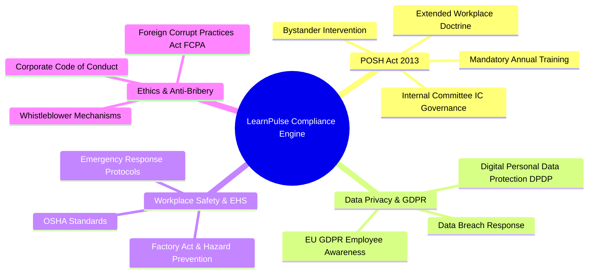

# 💼 Business Strategy & Enterprise Compliance Whitepaper
**Platform:** LearnPulse / Worxpertise Enterprise E-Learning Platform  
**Target Audience:** Chief Human Resources Officers (CHRO), General Counsel & Legal Officers, Chief Information Security Officers (CISO), Corporate Executives  
**Version:** 2.0  

---

## 1. Executive Summary & Problem Statement

Modern corporations operate under stringent, continuously evolving regulatory environments. In India and across global markets, compliance training is no longer an optional HR perk—it is a **statutory legal requirement**.

### The Critical Business Challenge:
- **High In-Person Training Costs:** Traditional physical classroom seminars cost ₹2,500 – ₹5,000 per employee per session in trainer fees, lost productivity, and logistical overhead.
- **Superficial "Check-the-Box" Training:** Standard video players allow employees to click "play", mute the tab, skip to the end, and falsely claim completion without learning.
- **Audit Vulnerability:** When regulatory audits or workplace harassment complaints occur, companies without tamper-proof timestamps and verified test scores face severe legal liability, fines, and reputational damage.

### The LearnPulse Solution:
LearnPulse provides a fully automated, anti-cheat corporate compliance LMS that delivers statutory training at a **fraction of the cost**, with **ironclad legal audit defensibility**.

---

## 2. Statutory Compliance Mandates Supported

### 2.1 POSH Act 2013 (Prevention of Sexual Harassment at Workplace)
- **Legal Mandate:** Under Section 19 of the Sexual Harassment of Women at Workplace Act 2013, every employer must organize regular sensitization workshops for all employees.
- **Annual Filing Requirement:** Companies must file an Annual Compliance Report to the District Officer detailing the number of sensitization programs conducted.
- **LearnPulse Defense:** Generates auditable Excel rosters and digital certificates proving that every employee completed the statutory curriculum and passed the proctored assessment.

### 2.2 Digital Personal Data Protection (DPDP) Act & EU GDPR
- Mandates employee training on data classification, confidentiality, and data breach reporting protocols.

### 2.3 OSHA Workplace Safety & EHS
- Mandatory health and safety compliance for industrial, technical, and corporate work environments.

---

## 3. Financial ROI & Cost-Benefit Analysis

### Cost Comparison: 1,000 Employees Corporate Cohort

| Cost Element | Traditional Classroom Training | Legacy Third-Party LMS | LearnPulse Enterprise LMS |
| :--- | :---: | :---: | :---: |
| **Trainer / Speaker Fees** | ₹1,50,000 – ₹3,00,000 | ₹0 | **₹0 (Pre-packaged faculty)** |
| **Employee Downtime Cost** | 4 hours per employee | 1 hour per employee | **45 minutes self-paced** |
| **Platform / Licensing Fee** | ₹0 | ₹800 – ₹1,200 / user / yr | **₹150 – ₹300 / user / yr** |
| **Audit Defense & Tracking** | Manual paper sign-off sheets | Basic CSV export | **Tamper-proof digital ledger & SHA-256 QR code** |
| **Total Annual Cost (1,000 Users)** | **₹12,50,000+** | **₹10,00,000+** | **₹2,00,000 – ₹3,00,000** |
| **Net Corporate Savings** | Baseline | ~20% | **75% – 85% Savings** 🚀 |

---

## 4. Competitive Differentiation Matrix

| Capability | Generic Open-Source LMS (Moodle / Canvas) | Commercial Big-Tech LMS (Cornerstone / Coursera) | LearnPulse Enterprise |
| :--- | :---: | :---: | :---: |
| **Anti-Fast-Forward Enforcement** | ❌ Complex plugin required | ⚠️ Variable by vendor | ✅ **Native Zero-Cheat Player** |
| **Tab-Blur / Minimize Alert** | ❌ None | ❌ None | ✅ **Built-in Visibility Defense** |
| **Dual-Signatory Dynamic Certificate** | ❌ Static image templates | ⚠️ Fixed layouts | ✅ **Live Authority + Seal Preview** |
| **Public QR Verification** | ❌ Requires custom portal | ⚠️ Subscription add-on | ✅ **Instant Public QR Verification** |
| **Case 1: Sequential Course Re-assignment** | ❌ Overwrites enrollments | ⚠️ Complex workflow builder | ✅ **1-Click Filter & Bulk Assign** |
| **Lightweight Load Latency** | ❌ Heavy PHP / 5s+ load time | ⚠️ Heavy SPA / 4s load time | ✅ **Ultra-fast (<1.5s load latency)** |

---

## 5. Commercial Licensing & Monetization Models

### Model A: Per-User-Per-Month (PUPM) SaaS
- **Target:** Startups, Mid-Market companies (50 to 1,000 employees).
- **Pricing:** ₹25 to ₹50 / user / month billed annually.
- **Includes:** Full course catalog, proctored quizzes, and automated certificate issuance.

### Model B: Enterprise Annual Site License (Unlimited Seats)
- **Target:** Large Enterprises (1,000 to 50,000+ employees).
- **Pricing:** ₹3,50,000 to ₹12,00,000 flat annual fee.
- **Includes:** Dedicated cloud instance, custom domain, single sign-on (SSO), and custom signatory seals.

### Model C: White-Label OEM Licensing
- **Target:** Corporate Training Consultancies, Legal Firms, POSH IC Advisors.
- **Pricing:** Setup fee + revenue share.
- **Value:** Consultancies sell the platform to their own corporate clients under their brand name.

---

## 6. Enterprise Legal & Audit Readiness Checklist

When legal authorities, internal auditors, or statutory bodies request training compliance records, LearnPulse provides:
1. **Timestamped Roster Export:** Detailed Excel spreadsheet with user IDs, employee names, corporate emails, completion dates, and exam percentage scores.
2. **Cryptographic Certificate Verification:** Every certificate features a permanent SHA-256 hash and scannable QR code verified against the database.
3. **Immutable Audit Logs:** An uneditable log showing the exact date, time, and IP address from which administrative actions were executed.
