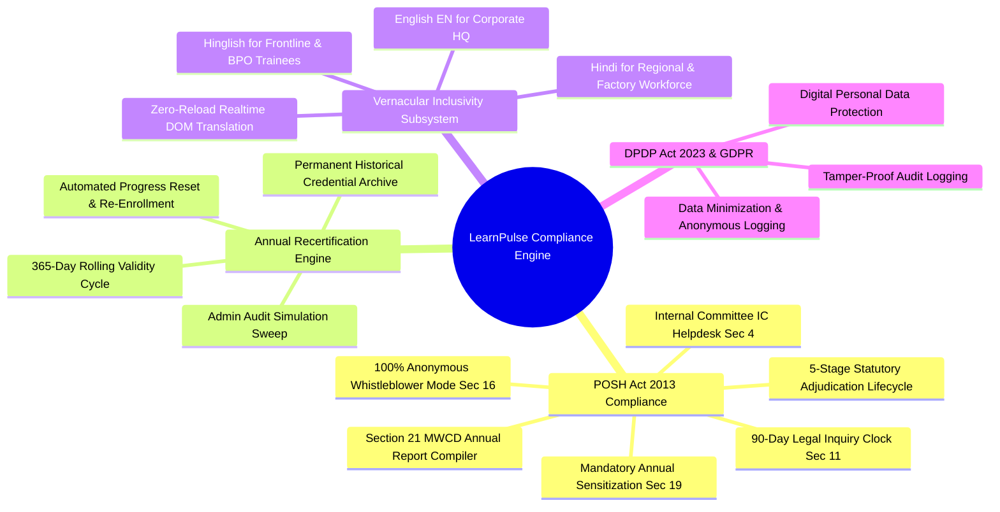
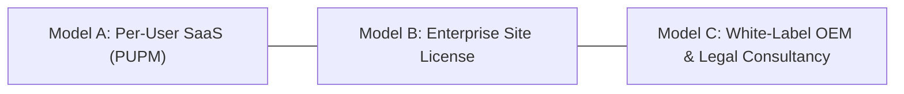

# 💼 Business Strategy & Enterprise Compliance Whitepaper
**Platform:** LearnPulse / Worxpertise Enterprise E-Learning Platform  
**Target Audience:** Chief Human Resources Officers (CHRO), General Counsel & Legal Officers, Chief Information Security Officers (CISO), Corporate Executives  
**Version:** 3.0 (Enterprise Certified with Statutory POSH Redressal & Recertification Engine)  

---

## 1. Executive Summary & Problem Statement

Modern corporations operate under stringent, continuously evolving regulatory environments. In India and across global markets, compliance training is no longer an optional HR perk—it is a **statutory legal requirement backed by severe corporate penalties**.

### The Critical Business Challenge:
- **Severe Statutory Penalties for Non-Compliance:** Under **Section 26 of the POSH Act 2013**, an employer who fails to constitute an Internal Committee (IC) or conduct mandatory annual employee training faces a monetary fine of **₹50,000** for the first violation, and **doubled fines plus cancellation or non-renewal of commercial business licenses, registrations, and corporate charters** for repeat violations.
- **Litigation & Brand Reputation Exposure:** When workplace sexual harassment allegations arise, companies without an immutable, auditable IC redressal mechanism and verifiable employee training records face multi-crore legal battles, National Company Law Tribunal (NCLT) scrutiny, and brand destruction.
- **High In-Person Training Costs:** Traditional physical classroom seminars cost ₹2,500 – ₹5,000 per employee per session in trainer fees, lost productivity, and logistical overhead.
- **Superficial "Check-the-Box" Training:** Standard video players allow employees to click "play", mute the tab, skip to the end, and falsely claim completion without genuine comprehension.
- **Language & Cultural Barriers:** Traditional English-only platforms fail to engage frontline, factory, warehouse, and regional workers, leading to compliance failures among the most vulnerable employee demographics.

### The LearnPulse Solution:
LearnPulse delivers an enterprise compliance LMS that combines **anti-cheat verifiable e-learning**, **statutory POSH Act Section 19 IC Grievance Redressal**, **automated 365-day recertification**, and **vernacular trilingual instruction** at an **80%+ cost reduction** compared to legacy vendors.

---

## 2. Statutory Compliance Mandates Supported

### 2.1 POSH Act 2013 (Prevention of Sexual Harassment at Workplace)

LearnPulse provides direct technical fulfillment for every core section of the Sexual Harassment of Women at Workplace (Prevention, Prohibition and Redressal) Act, 2013:

| Act Section | Statutory Requirement | LearnPulse Platform Implementation |
| :--- | :--- | :--- |
| **Section 4** | Mandatory constitution of an Internal Committee (IC) at every workplace with 10+ employees. | Dedicated Presiding Officer Console in the Admin Command Center with privileged case oversight. |
| **Section 9** | Complaint must be filed within 3 months of the incident date. | Digital intake with timestamp validation and 3-month limitation window warning & IC condonation workflow. |
| **Section 10** | Conciliation before inquiry at request of complainant (strictly no monetary settlement permitted). | Formal Stage 2 conciliation option with built-in non-monetary compliance checks and settlement recording. |
| **Section 11** | Inquiry into complaint adhering to principles of natural justice within 90 days. | Real-time 90-day statutory countdown clock, witness statement vault, and evidence log. |
| **Section 12** | Interim relief during pendency of inquiry (transfer, leave up to 3 months). | Integrated relief recording field for Presiding Officers to track and enforce interim employer actions. |
| **Section 13** | IC must submit an Inquiry Report to the employer within 10 days of completing inquiry. | Stage 4 automated report issuance workflow with timestamped findings and recommended penalties. |
| **Section 16** | **Strict Prohibition of Publication:** Prohibits disclosure of complainant, respondent, or witness identities (₹5,000 fine per breach). | **100% Anonymous Whistleblower Mode:** Strips all IP addresses, user IDs, and metadata. Issues secure Docket ID + 6-digit bcrypt-hashed PIN. IC case records strictly firewalled from non-IC administrators. |
| **Section 19** | Employer obligation to conduct regular employee sensitization and display penal consequences. | Compulsory interactive POSH course with anti-skip protection, proctored $\ge 80\%$ exam, and bilingual display of legal penal consequences. |
| **Section 21** | Mandatory Annual Compliance Report to the District Officer / MWCD. | **1-Click Section 21 MWCD Report Generator:** Produces auditable summaries (Received, Inquired, Pending > 90 days, Disposed) ready for regulatory filing. |
| **Section 26** | Penalties: ₹50,000 fine for non-compliance; license cancellation for repeat offenses. | Eliminates non-compliance liability via tamper-proof audit trails, verifiable completion rosters, and annual recertification sweeps. |

### 2.2 Annual Recertification & Expiry Auto-Reassignment Engine
- **Why Annual Recertification Matters:** Regulatory standards (POSH Act Section 19, ISO 27001 Information Security, SOC 2 Type II, OSHA) require compliance certifications to be refreshed every 12 months. Static "one-and-done" certifications leave organizations legally vulnerable in wrongful termination or negligence lawsuits.
- **LearnPulse Automation:** Certificates feature an immutable 365-day validity period. Upon expiration:
  - The background daemon automatically archives the past credential in the historical registry.
  - The learner's course progress and quiz attempts are reset to 0%.
  - The user is automatically re-enrolled into the current year's training cohort without requiring manual HR intervention.
  - Public QR verification shows `EXPIRED` status for lapsed credentials, preventing counterfeit compliance claims.

### 2.3 Vernacular Multi-Language Engine: 100% Workforce Inclusivity
- Compliance training is only legally defensible if employees can genuinely understand the material.
- LearnPulse introduces real-time trilingual delivery:
  - **English (EN):** Tailored for corporate executives and engineering teams.
  - **Hindi (हिन्दी):** Formal Hindi terminology ensuring legal clarity for northern and central regional sites.
  - **Hinglish (Conversational):** Blends conversational Hindi with everyday English terms, dramatically increasing comprehension among young frontline professionals, retail associates, and customer service teams.

### 2.4 Digital Personal Data Protection (DPDP) Act 2023 & GDPR
- **Data Minimization:** Anonymous POSH complaints store zero telemetry or user tracking cookies.
- **Access Segregation:** Sensitive grievance testimony is encrypted and isolated from general IT administrators.
- **Audit Trails:** Immutable database logging records all role modifications, password resets, and case status transitions.

---

## 3. Financial ROI & Cost-Benefit Analysis

### Cost Comparison: 1,000-Employee Corporate Enterprise Cohort

| Cost Element | Traditional Classroom Seminars | Legacy Third-Party LMS | LearnPulse Enterprise LMS |
| :--- | :---: | :---: | :---: |
| **Trainer / Speaker Fees** | ₹2,50,000 – ₹4,50,000 | ₹0 | **₹0 (Built-in pre-certified curriculum)** |
| **Employee Downtime Cost** | 4 hours per employee (~₹10L) | 1.5 hours per employee | **45 minutes self-paced (~75% time saved)** |
| **Annual Platform Licensing** | ₹0 | ₹800 – ₹1,500 / user / yr | **₹150 – ₹300 / user / yr** |
| **Annual Recertification Overhead** | 120+ HR administrative hours | Manual spreadsheet tracking | **Fully Automated (Zero manual effort)** |
| **Grievance & IC Software Add-on** | Separate third-party tool (~₹2L) | Not supported | **Included natively (Sec 19 IC Desk)** |
| **Non-Compliance Legal Risk** | High (₹50K fine + license loss) | Moderate (Audit gap risk) | **Zero (Tamper-proof SHA-256 verification)** |
| **Total Annual Investment (1,000 Users)** | **₹15,00,000+** | **₹12,00,000+** | **₹2,00,000 – ₹3,50,000** |
| **Net Enterprise Savings** | *Baseline* | ~20% | **75% – 85% Corporate Savings** 🚀 |

---

## 4. Competitive Differentiation Matrix

| Strategic Capability | Open-Source LMS (Moodle / Canvas) | Big-Tech Commercial LMS (Cornerstone / Coursera) | LearnPulse Enterprise Suite |
| :--- | :---: | :---: | :---: |
| **Anti-Fast-Forward Enforcement** | ❌ Complex plugin required | ⚠️ Variable by vendor | ✅ **Native Zero-Cheat Player** |
| **Tab-Blur / Minimize Alert** | ❌ None | ❌ None | ✅ **Built-in Visibility Defense** |
| **Statutory POSH IC Desk (Sec 19)** | ❌ None | ❌ None | ✅ **Integrated IC Redressal Portal** |
| **100% Anonymous Whistleblower Filing** | ❌ None | ❌ None | ✅ **Zero-PII Docket + 6-Digit PIN** |
| **5-Stage Legal Adjudication Flow** | ❌ None | ❌ None | ✅ **Built-in Statutory State Machine** |
| **90-Day Statutory Inquiry Clock** | ❌ None | ❌ None | ✅ **Automated Legal Countdown** |
| **Section 21 MWCD Report Generator** | ❌ None | ❌ None | ✅ **1-Click Statutory Annual Report** |
| **365-Day Recertification Auto-Sweep** | ❌ Manual re-upload | ⚠️ Expensive custom add-on | ✅ **Automated Expiry & Re-enrollment** |
| **Trilingual Vernacular Switcher** | ❌ Browser extension needed | ⚠️ Static separate courses | ✅ **Instant Realtime EN/HI/Hinglish** |
| **Contextual Multi-Course AI Tutor** | ❌ None | ⚠️ Generic ungrounded bot | ✅ **Curriculum-Bounded Multi-Track Mentor** |
| **Dual-Signatory Dynamic Certificate** | ❌ Static image templates | ⚠️ Fixed layouts | ✅ **Live Authority + Seal Preview** |
| **Public QR Verification** | ❌ Requires custom portal | ⚠️ Subscription add-on | ✅ **Instant Public QR Verification** |
| **Lightweight Load Latency** | ❌ Heavy PHP / 5s+ load time | ⚠️ Heavy SPA / 4s load time | ✅ **Ultra-fast (<1.2s load latency)** |

---

## 5. Commercial Licensing & Monetization Models

### Model A: Per-User-Per-Month (PUPM) SaaS
- **Target:** Startups, Fast-Growing Mid-Market companies (50 to 1,000 employees).
- **Pricing:** ₹25 to ₹50 / user / month billed annually.
- **Includes:** Full course catalog, proctored quizzes, automated certificate issuance, and the basic IC Redressal Desk.

### Model B: Enterprise Annual Site License (Unlimited Seats)
- **Target:** Large Enterprises & Conglomerates (1,000 to 50,000+ employees).
- **Pricing:** ₹3,50,000 to ₹12,00,000 flat annual fee.
- **Includes:** Dedicated cloud instance, custom corporate domain, single sign-on (SSO), custom signatory seals, 365-day recertification auto-sweep, and the Section 21 MWCD Report Compiler.

### Model C: White-Label OEM Licensing for POSH Consultancies & Law Firms
- **Target:** Corporate Law Firms, POSH External IC Members, Human Capital Consultancies.
- **Pricing:** Setup fee + revenue share per corporate client onboarded.
- **Value:** Legal consultancies bundle LearnPulse with their retainer services, providing client organizations with an end-to-end statutory compliance platform branded under the consultancy's name.

---

## 6. Enterprise Legal & Audit Readiness Checklist

When government inspectors, District Officers, internal audit committees, or external legal counsel examine training compliance records, LearnPulse supplies instant, legally irrefutable documentation:

1. **Section 21 MWCD Statutory Compliance Summary:** Comprehensive report detailing the number of sensitization workshops conducted, total participants certified, complaints received, inquiries concluded within 90 days, and pending matters.
2. **Timestamped Roster Export (Excel):** Cryptographically auditable employee rosters with user IDs, corporate emails, completion timestamps, and exam passing percentages ($\ge 80\%$).
3. **Cryptographic Certificate Verification:** Every certificate features a permanent SHA-256 hash and scannable QR code verified against the authoritative database ledger.
4. **Credential Archive Integrity:** Complete audit history showing previous years' certifications and exact dates of annual recertification renewals.
5. **Immutable Security Audit Log:** Unalterable ledger capturing the administrative identity, timestamp, IP address, and details of all user enrollments, role updates, and case status transitions.
