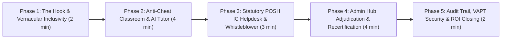

# 🎬 Executive Demo Script & Presentation Playbook
**Platform:** LearnPulse / Worxpertise Enterprise E-Learning & Compliance Platform  
**Target Audience:** Chief Human Resources Officers (CHRO), General Counsel & Legal Officers, Chief Information Security Officers (CISO), Corporate Executives, Procurement Panels  
**Demo Duration:** 12 to 15 Minutes (High-Impact Flow)  
**Version:** 3.0 (Enterprise Certified with Statutory POSH IC Desk, Recertification & AI Companion)  

---

## 1. Executive Pre-Demo Setup & Environment Checklist

### 1.1 Local / Demo URLs
- **Main Portal:** `http://localhost:5000/` (or your staging/LAN URL)
- **Direct Documentation Hub:** `http://localhost:5000/` $\rightarrow$ Sign in as Admin $\rightarrow$ **Product & Technical Docs**

### 1.2 Demo Credentials Matrix
| Role | Demo Account Email | Default Password | Key Showcase Objective |
| :--- | :--- | :--- | :--- |
| **👑 System Administrator & IC Presiding Officer** | `admin@learnpulse.dev` | `Admin@123` | Admin Hub, 5-Stage IC Console, 90-day clock, Recertification Engine, MWCD Report |
| **🎓 Learner / Trainee** | `learner@learnpulse.dev` | `Learner@123` | Anti-cheat video player, Vernacular switcher, Contextual AI Tutor, Dual-signatory certificate |
| **👨‍🏫 Faculty / Instructor** | `sarah.chen@learnpulse.dev` | `Instructor@123` | Faculty Studio, dynamic certificate signatory setup, student Q&A management |

---

## 2. Master Demo Flowchart (15-Minute Narrative Arc)



---

## 3. Minute-by-Minute Live Presentation Script

### 📍 Phase 1: The Opening Hook & Vernacular Inclusivity (Minutes 00:00 – 02:00)
**Screen:** Main Academy Landing Page (`http://localhost:5000/`)  
**Objective:** Differentiate LearnPulse from generic consumer LMS platforms (Coursera/Moodle) in the first 60 seconds.

#### 🎙️ Spoken Script (English & Hinglish):
> *"Good morning / afternoon everyone. Today, every enterprise in India and globally faces stringent regulatory compliance mandates—most notably the **POSH Act 2013**, ISO 27001, and the DPDP Act. Under Section 26 of the POSH Act, failure to conduct verifiable training carries a ₹50,000 fine and risk of business license cancellation.*
>
> *Most companies use generic platforms where employees just click 'play', mute the tab, skip to the end, and falsely claim completion. When an audit or complaint occurs, those certificates don't hold up in court.*
>
> *LearnPulse is different: It is an **anti-cheat, legally auditable, zero-compromise compliance platform** with a built-in statutory Internal Committee (IC) Helpdesk and automated 365-day recertification."*

#### 🖱️ Screen Actions:
1. Point to the header language toggle: **`🌐 EN | हिन्दी | Hinglish`**.
2. Click **`हिन्दी`** $\rightarrow$ Show the whole catalog, course titles, and UI translating in real time with zero page refresh.
3. Click **`Hinglish`** $\rightarrow$ Show conversational Hindi-English phrasing.
4. **Talking Point:** *"Frontline workers, warehouse staff, and regional BPO associates often struggle with legal English. Our zero-reload trilingual engine ensures 100% genuine workforce comprehension."*

---

### 📍 Phase 2: Learner Experience, Anti-Cheat Defense & AI Tutor (Minutes 02:00 – 06:00)
**Screen:** Course Catalog $\rightarrow$ Select **"POSH Act 2013: Workplace Harassment Prevention"** $\rightarrow$ Click **"Start Learning"**

#### 🎙️ Spoken Script:
> *"Now let's step into the shoes of an employee. Here is where LearnPulse proves its audit defensibility through two patent-grade security protections."*

#### 🖱️ Screen Actions:
1. **Showcase Anti-Skip Protection:**
   - Start the video lesson.
   - Attempt to drag the seekbar forward to skip the lesson.
   - **Show:** The player immediately resets playback and blocks the skip.
   - **Talking Point:** *"Employees cannot fast-forward. Real watching seconds are strictly enforced."*
2. **Showcase Tab-Focus & Minimize Defense:**
   - Switch to another browser tab or minimize the browser window.
   - Return to the tab: **Show the Tab-Blur Warning alert** and show that the video paused automatically.
   - **Talking Point:** *"If an employee leaves the training window to check emails or watch YouTube, the course halts. This gives legal counsel 100% proof that the trainee was actively present."*
3. **Showcase Contextual Multi-Course AI Tutor:**
   - Click the floating **`💬 AI Tutor`** badge in the bottom-right corner.
   - Ask: *"What is quid pro quo harassment?"* or click a quick prompt pill.
   - **Show:** The AI provides an exact, course-grounded legal explanation.
   - Mention: *"If the learner switches to a Full-Stack or Cybersecurity track, the AI Tutor automatically shifts persona into a Senior Technical Mentor."*
4. **Showcase Proctored Assessment & Dynamic Dual-Signatory Certificate:**
   - Launch the quiz (passing threshold $\ge 80\%$).
   - Show the generated Certificate:
     - Dynamic signatures of Lead Faculty + Governing Dean.
     - Photorealistic gold corporate seal.
     - Unique immutable Credential ID (e.g. `CERT-LP-POSH-2026-9481`).
     - **Scannable public QR code** for instantaneous mobile verification.

---

### 📍 Phase 3: Statutory POSH Grievance & Whistleblower Helpdesk (Minutes 06:00 – 09:00)
**Screen:** Home Catalog $\rightarrow$ POSH Course Card $\rightarrow$ Click **`[⚖️ IC Desk]`** button (or navigation bar)  
**Objective:** Present the single biggest competitive differentiator that no other LMS in the industry offers.

#### 🎙️ Spoken Script:
> *"Under Section 19 of the POSH Act, employers must provide an accessible grievance redressal mechanism. But in reality, employees fear retaliation and rarely complain using their corporate email.*
>
> *Under Section 16, disclosing complainant identity carries severe legal penalties. LearnPulse solves this with a **100% Anonymous Whistleblower Helpdesk**."*

#### 🖱️ Screen Actions:
1. **Open the IC Redressal Modal:**
   - Show the two submission modes: **Confidential Identified Mode** vs **100% Anonymous Whistleblower Mode**.
   - Select **Anonymous Whistleblower Mode**.
   - Fill in a sample incident: Date, Location (e.g. *Gurugram Office / Zoom Meeting*), Accused Person, Narrative.
   - Click **Submit Statutory Complaint to IC**.
2. **Highlight the Whistleblower Token Generation:**
   - **Show the popup:** The platform generates a unique **Docket ID** (e.g. `POSH-2026-4921`) and a **6-Digit Secret PIN**.
   - **Talking Point:** *"All IP addresses, cookies, and user IDs are stripped. Only the holder of this Docket ID and PIN can view case progress. Complete Section 16 compliance."*
3. **Showcase Anonymous Case Tracking:**
   - Switch to the **`🔍 Track Docket Status`** tab.
   - Enter the Docket ID + 6-digit PIN $\rightarrow$ Click **Check Status**.
   - Show the real-time stage progression and IC hearing notes.
4. **Showcase Interactive Legal Workflow Guide:**
   - Click **`📘 Legal Workflow Guide`**.
   - Walk through the interactive 5-stage legal lifecycle, statutory timelines, and conciliation boundaries under Section 10.

---

### 📍 Phase 4: Admin Executive Command Center & Recertification Engine (Minutes 09:00 – 13:00)
**Screen:** Sign in as `admin@learnpulse.dev` $\rightarrow$ Open **Admin Control Hub**

#### 🎙️ Spoken Script:
> *"Now let's switch to the executive view. As HR Head, Compliance Director, or Internal Committee Presiding Officer, you have a centralized command center to oversee compliance health, adjudicate grievances, and automate annual recertifications."*

#### 🖱️ Screen Actions:
1. **2-Column Responsive Flyout:**
   - Show the solid `#0b0f19` dark menu with zero screen-edge clipping.
2. **Presiding Officer IC Adjudication Console:**
   - Open **POSH IC Redressal**.
   - Find the complaint submitted in Phase 3.
   - **Highlight 1: 90-Day Statutory Countdown Clock:** Shows exact legal deadline under Section 11(4).
   - **Highlight 2: 5-Stage Status Sequence Dropdown:**
     1. `Formal Complaint Filed` (Intake acknowledgement)
     2. `Notice & Conciliation Under Sec 10`
     3. `Formal IC Inquiry Under Sec 11`
     4. `Inquiry Report Issued Under Sec 13`
     5. `Management Action Taken Under Sec 19/21`
   - **Highlight 3: Section 21 MWCD Annual Report Compiler:**
     - Click **`📄 Export MWCD Annual Report`**.
     - Show the statutory compliance summary table ready for immediate submission to the District Officer and Ministry of Women & Child Development.
3. **Annual Recertification & Expiry Auto-Reassignment Engine:**
   - **Talking Point:** *"Compliance is not one-and-done. POSH, ISO, and cyber certifications must be renewed every 365 days. Managing this on Excel sheets takes 120+ hours of HR time annually."*
   - Click **`🔄 Run Recertification Sweep / Test Simulation`**.
   - **Show:** The system checks all credentials, archives expired certificates into historical records, resets progress/quiz to 0%, and re-enrolls trainees into the current year's cohort in under 1 second!
4. **User Directory & 1-Click Account Unlock:**
   - Show how accounts locked after 3 brute-force failed passwords display a flashing **`🔒 LOCKED`** badge and can be unlocked in **1-click (`🔓 Unlock Account`)**.
   - Show **Case 1 Sequential Assignment:** Filter by `Completed: POSH Compliance` $\rightarrow$ Select all $\rightarrow$ 1-click assign `Cybersecurity`.

---

### 📍 Phase 5: Tamper-Proof Audit Trail, VAPT Security & ROI Closing (Minutes 13:00 – 15:00)
**Screen:** Admin Hub $\rightarrow$ **Product & Technical Docs**

#### 🎙️ Spoken Script:
> *"Finally, when government auditors or enterprise security teams inspect your organization, where do you stand?"*

#### 🖱️ Screen Actions:
1. Open the in-app **Product & Technical Docs Studio**:
   - Tab 1: **Technical Specs & VAPT Audit** $\rightarrow$ Show the **OWASP Top 10 PASS Matrix (SEC-01 to SEC-14)**.
   - Tab 2: **Role-Based User Operational Manual**.
   - Tab 3: **Business & Statutory Compliance Whitepaper**.
   - Tab 4: **System Architecture & Load Capacity** $\rightarrow$ Show the **4,000 QPS database pool math** and 30,000+ concurrent user capability.
2. Click **`📥 Download .MD`** or **`🖨️ Print Document`** to show client-ready exportability.

#### 🎯 Closing Punchline:
> *"In summary, LearnPulse saves an enterprise of 1,000 employees over ₹12 Lakhs per year (75% to 85% cost savings), completely eliminates Section 26 non-compliance penalties, and protects company reputation with an ironclad, tamper-proof legal defense. Thank you, and we'd love to take your questions."*

---

## 4. Objection Handling & Client Q&A Defense Matrix

| Client Question / Objection | Winning Response |
| :--- | :--- |
| **"Why shouldn't we just use Moodle or an open-source LMS?"** | *"Moodle is designed for academic homework, not legal compliance. It lacks native anti-skip enforcement, tab-blur pausing, anonymous POSH whistleblower filing, 90-day statutory clocks, MWCD Section 21 reporting, and 365-day automated recertification. You would need ₹10 Lakhs+ in custom plugin engineering to match LearnPulse."* |
| **"Can employees bypass video watching by fast-forwarding or running browser scripts?"** | *"No. The player enforces real watching seconds via `maxWatchedSeconds` on the client and validates completion on the backend before quiz unlock. Even if an employee tampers with client code, the server rejects unearned certificate requests."* |
| **"How does the anonymous POSH whistleblower mode protect identity?"** | *"Under Section 16 of the POSH Act, identity disclosure carries severe fines. In anonymous mode, the backend strips all IP addresses, user IDs, and session tokens before writing to PostgreSQL. Only the 6-digit bcrypt-hashed PIN + Docket ID can query the case status."* |
| **"Can we deploy this on our private internal LAN or AWS VPC without public internet?"** | *"Yes! LearnPulse is self-contained. It can run on a private office server, air-gapped intranet, or your corporate AWS/Azure VPC with PostgreSQL. All video streams can be served from private S3 buckets or local MP4 files."* |
| **"How does the system handle high load when 5,000 employees take training on the same day?"** | *"Our Edge-Decoupled architecture routes all heavy video streaming directly to global CDNs. The backend handles only lightweight JSON progress telemetry (< 1KB per request). With our connection pool benchmarked at 4,000 QPS, even a single mid-tier server sustains thousands of concurrent users easily."* |

---

## 5. 1-Page Quick-Reference Presenter Cheat Sheet

Print or keep this 1-page summary open on your secondary screen during the live demo:

```
┌─────────────────────────────────────────────────────────────────────────────┐
│                       LEARNPULSE DEMO QUICK SHEET                           │
├─────────┬──────────────────────┬────────────────────────────────────────────┤
│ Minute  │ Phase                │ Key Actions & Click Path                   │
├─────────┼──────────────────────┼────────────────────────────────────────────┤
│ 00 - 02 │ 1. Opening Hook      │ • Open localhost:5000                      │
│         │                      │ • Toggle EN -> हिन्दी -> Hinglish          │
│         │                      │ • Pitch statutory compliance & anti-cheat  │
├─────────┼──────────────────────┼────────────────────────────────────────────┤
│ 02 - 06 │ 2. Learner Classroom │ • Open POSH Course -> "Start Learning"     │
│         │    & Anti-Cheat      │ • Try fast-forward (Seekbar blocked!)      │
│         │                      │ • Switch browser tab (Tab-blur warning!)   │
│         │                      │ • Open AI Tutor (Contextual POSH help)     │
│         │                      │ • Pass Quiz -> Show QR-code Certificate    │
├─────────┼──────────────────────┼────────────────────────────────────────────┤
│ 06 - 09 │ 3. POSH IC Helpdesk  │ • Click [⚖️ IC Desk] on POSH card          │
│         │    & Whistleblower   │ • Select "100% Anonymous Whistleblower"    │
│         │                      │ • Submit -> Show Docket ID + 6-digit PIN   │
│         │                      │ • Track Docket Status tab                  │
│         │                      │ • Open Legal Workflow Guide (5 stages)     │
├─────────┼──────────────────────┼────────────────────────────────────────────┤
│ 09 - 13 │ 4. Admin Command Hub │ • Open Admin Hub (2-column dark menu)      │
│         │    & Recertification │ • POSH IC Desk -> Show 90-day clock        │
│         │                      │ • Click "Export MWCD Annual Report"        │
│         │                      │ • Click "Run Recertification Simulation"   │
│         │                      │ • User Directory -> 1-Click Unlock Account │
│         │                      │ • Case 1: Bulk assign Course 2 to completers│
├─────────┼──────────────────────┼────────────────────────────────────────────┤
│ 13 - 15 │ 5. VAPT Docs & ROI   │ • Open "Product & Technical Docs" in Admin │
│         │                      │ • Show OWASP Top 10 PASS Matrix (SEC 01-14)│
│         │                      │ • Pitch 75%-85% ROI and closing call-to-act│
└─────────┴──────────────────────┴────────────────────────────────────────────┘
```
